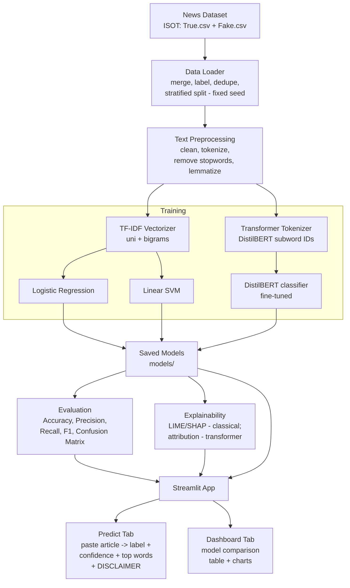

# Architecture

## Pipeline overview

```
News Dataset
   → Text Preprocessing
   → Feature Extraction (TF-IDF + transformer embeddings)
   → Model Training (Logistic Regression / SVM / Transformer)
   → Classification (Fake / Real)
   → Web Interface
   → Results & Evaluation Dashboard
```

## Diagram



## Stage-by-stage explanation

### 1. News Dataset
Raw labelled articles with full body text (see `dataset.md`). Loaded and merged by
`src/data_loader.py`, which attaches labels, removes duplicates, shuffles with a
fixed seed, and produces a **stratified** train / validation / test split.

### 2. Text Preprocessing (`src/preprocessing.py`)
Operates on the **full article text**. Steps:
- Lowercase; strip URLs, HTML, emails, and non-alphabetic noise.
- Strip source datelines/bylines (e.g. "(Reuters)") to reduce the dataset artefact
  described in `dataset.md`.
- Tokenize (NLTK or spaCy).
- Remove stopwords.
- Lemmatize to collapse inflected forms.
- Return cleaned text for TF-IDF.
> Note: the transformer path uses its **own subword tokenizer** and only needs light
> cleaning (URL/HTML removal). Aggressive lemmatization/stopword removal is applied
> to the **classical** path, not fed to DistilBERT.

### 3. Feature Extraction (`src/features.py`)
- **Classical path:** `TfidfVectorizer` with unigrams + bigrams, a sensible
  `max_features` cap, and `min_df` filtering. The fitted vectorizer is **saved** so
  the app transforms new input identically.
- **Transformer path:** the pretrained tokenizer converts text to subword IDs;
  contextual embeddings are produced inside the model during fine-tuning.

### 4. Model Training (`src/train.py`)
Trains and saves three models:
- **Logistic Regression** (TF-IDF) — fast, interpretable baseline.
- **Linear SVM** (TF-IDF) — strong linear text classifier (with calibrated
  probabilities so the app can show a confidence score).
- **DistilBERT** (fine-tuned) — transformer baseline via Hugging Face.
All randomness is seeded. Artefacts saved to `models/`.

### 5. Classification (Fake / Real)
Each model outputs a label plus a **confidence / probability**. This probability is
presented as a *signal*, never as proof (see disclaimer in `problem-statement.md`).

### 6. Explainability (`src/explain.py`)
- **Classical models:** LIME (and/or SHAP) to surface the top words pushing a given
  article toward Fake or Real. Logistic Regression also exposes global coefficients.
- **Transformer:** token-level feature attribution (e.g. integrated gradients /
  attention-based attribution) highlighting influential tokens.

### 7. Web Interface + Dashboard (`src/app.py`, Streamlit)
- **Predict tab:** paste an article → label + confidence + highlighted influential
  words + a **prominent, always-visible disclaimer**.
- **Dashboard tab:** side-by-side model comparison — metrics table plus charts
  (bar chart of metrics, confusion matrices) loaded from saved evaluation results.

## Design principles
- **Modularity:** separate modules for data, preprocessing, features, training,
  evaluation, explainability, and the app.
- **Reproducibility:** fixed seeds everywhere; saved vectorizer + models so the app
  and evaluation use identical transforms.
- **Honesty:** cross-dataset evaluation and explainability are first-class, so the
  system's limitations are visible rather than hidden.
